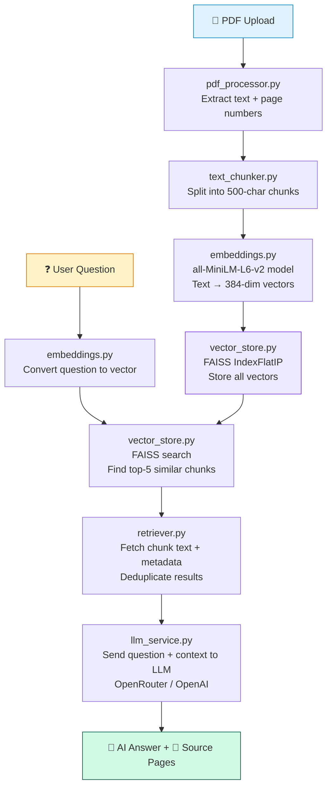

# DocuMind AI – Ask Your Documents

> **A complete beginner-friendly RAG (Retrieval-Augmented Generation) project**
> built with Python, Streamlit, FAISS, Sentence Transformers, and an LLM API.

---

## 📋 Table of Contents

1. [What does this project do?](#1-what-does-this-project-do)
2. [What is RAG? (Simple explanation)](#2-what-is-rag-simple-explanation)
3. [Technologies used](#3-technologies-used)
4. [Project folder structure](#4-project-folder-structure)
5. [How to set up on Windows](#5-how-to-set-up-on-windows)
6. [How to configure the LLM API key](#6-how-to-configure-the-llm-api-key)
7. [How to run the application](#7-how-to-run-the-application)
8. [How to use the app](#8-how-to-use-the-app)
9. [How the RAG pipeline works internally](#9-how-the-rag-pipeline-works-internally)
10. [Architecture diagram](#10-architecture-diagram)
11. [Common errors and solutions](#11-common-errors-and-solutions)
12. [How to run tests](#12-how-to-run-tests)
13. [Known limitations](#13-known-limitations)
14. [Exam viva explanation](#14-exam-viva-explanation)

---

## 1. What does this project do?

**DocuMind AI** lets you upload any PDF document and ask questions about it
in plain English. The application:

- Reads your PDF and extracts the text.
- Splits the text into small chunks.
- Converts all chunks into numbers (called *embeddings*) that capture their meaning.
- Stores these embeddings in a fast search index (FAISS).
- When you ask a question, it finds the most relevant chunks using semantic search.
- Sends only those relevant chunks to an AI model (LLM) to generate a readable answer.
- Shows you exactly which page and file the answer came from.

This is called **RAG – Retrieval-Augmented Generation**.

---

## 2. What is RAG? (Simple explanation)

Imagine you're preparing for an exam using a 200-page textbook. When a friend asks
"What is photosynthesis?", you don't read the whole book aloud. Instead:

1. You **retrieve** the relevant page (e.g., page 47 – the chapter on plants).
2. You **read that page** and **generate** an answer in your own words.

That's exactly what RAG does:

| Step | What happens |
|------|-------------|
| **R – Retrieve** | Find the most relevant paragraphs from your document |
| **A – Augmented** | Add those paragraphs as extra context |
| **G – Generation** | Ask an LLM to write an answer using only those paragraphs |

**Why is this better than just using ChatGPT?**
- ChatGPT doesn't know your specific document.
- Sending the entire document to an LLM is expensive and slow.
- RAG finds the right 3-5 paragraphs and sends only those – fast and cheap.
- Answers are grounded in YOUR document, so they're more accurate.

---

## 3. Technologies used

| Technology | What it does | Why we chose it |
|-----------|-------------|----------------|
| **Python 3.10** | Programming language | Simple, widely used for AI/ML |
| **Streamlit** | Web interface | Creates full web apps with only Python – no HTML/JS needed |
| **PyMuPDF (fitz)** | PDF text extraction | Fast and reliable PDF reader |
| **Sentence Transformers** | Text → Embeddings | Runs locally, no API key needed, very accurate |
| **FAISS CPU** | Vector similarity search | Fast index by Facebook AI, works on laptop CPU |
| **OpenAI / OpenRouter** | Answer generation (LLM) | Industry-standard API, OpenRouter has free models |
| **python-dotenv** | Configuration | Loads API keys safely from a `.env` file |
| **pytest** | Automated testing | Simple, widely used Python test framework |

---

## 4. Project folder structure

```
documind-rag/
│
├── app.py                  ← Main web application (run this!)
├── requirements.txt        ← List of Python packages to install
├── .env.example            ← Template for your API key config
├── .env                    ← Your actual config (DON'T share this!)
├── .gitignore              ← Tells Git which files to ignore
├── README.md               ← This file
│
├── src/                    ← All the backend logic
│   ├── __init__.py         ← Makes 'src' a Python package
│   ├── pdf_processor.py    ← Opens PDFs and extracts text page by page
│   ├── text_chunker.py     ← Splits long text into small overlapping pieces
│   ├── embeddings.py       ← Converts text chunks to number vectors
│   ├── vector_store.py     ← Stores vectors in FAISS; handles similarity search
│   ├── retriever.py        ← Finds the most relevant chunks for a question
│   ├── llm_service.py      ← Sends question + context to LLM; gets answer
│   └── rag_pipeline.py     ← Connects all modules into one complete workflow
│
├── tests/                  ← Automated tests
│   ├── __init__.py
│   ├── test_pdf_processor.py  ← Tests for PDF reading
│   ├── test_text_chunker.py   ← Tests for chunking
│   └── test_retriever.py      ← Tests for retrieval + LLM config
│
└── sample_documents/       ← Put your test PDFs here
    └── README.md
```

---

## 5. How to set up on Windows

### Step 1: Make sure Python is installed

Open PowerShell and type:
```powershell
python --version
```
You should see `Python 3.10.x` or higher. If not, download it from https://www.python.org/downloads/

### Step 2: (Optional but recommended) Create a virtual environment

A virtual environment keeps this project's packages separate from other Python projects.

```powershell
# Navigate to the project folder
cd d:\ml_project\documind-rag

# Create a virtual environment named 'venv'
python -m venv venv

# Activate the virtual environment
.\venv\Scripts\Activate.ps1
```

> **PowerShell tip:** If you see an error about "running scripts is disabled", run:
> `Set-ExecutionPolicy -ExecutionPolicy RemoteSigned -Scope CurrentUser`
> Then try activating again.

You'll see `(venv)` appear at the start of your prompt when it's active.

### Step 3: Install all dependencies

```powershell
pip install -r requirements.txt
```

This installs everything listed in `requirements.txt`. It may take 2-5 minutes
on the first run because it downloads ~500 MB of packages (PyTorch, etc.).

---

## 6. How to configure the LLM API key

The LLM (AI model) generates readable answers from the retrieved document chunks.
You need an API key to use it. The easiest option is **OpenRouter** – it's free to sign up
and provides access to powerful models including free-tier ones.

### Option A: OpenRouter (Recommended – Free tier available)

1. Go to https://openrouter.ai and sign up (free, no credit card needed for free models).
2. Go to **Keys** and create a new API key.
3. Copy the key (starts with `sk-or-...`).

### Option B: OpenAI

1. Go to https://platform.openai.com/api-keys
2. Create a new API key (starts with `sk-...`).
3. Note: Requires adding credit to your account.

### Configure the key

```powershell
# In the project folder (d:\ml_project\documind-rag)
Copy-Item .env.example .env
notepad .env
```

Edit `.env` and replace `your_api_key_here` with your actual key:

```env
LLM_PROVIDER=openrouter
LLM_API_KEY=sk-or-your-actual-key-here
LLM_MODEL=google/gemma-3-27b-it:free
```

> **⚠️ IMPORTANT:** Never share your `.env` file or commit it to GitHub.
> It's already in `.gitignore` so it won't be accidentally uploaded.

### Run without an API key (offline mode)

You can still use the app without an API key! You'll be able to:
- Upload PDFs ✅
- Extract text ✅
- Search and see relevant document passages ✅
- NOT get AI-generated answers ❌ (but the retrieved passages are still shown)

---

## 7. How to run the application

```powershell
# Make sure you're in the project folder
cd d:\ml_project\documind-rag

# (If using virtual environment, activate it first)
.\venv\Scripts\Activate.ps1

# Run the app
streamlit run app.py
```

Your browser will automatically open to `http://localhost:8501`.

If it doesn't open automatically, open your browser and go to: `http://localhost:8501`

---

## 8. How to use the app

1. **Upload a PDF** using the "Upload a PDF" button in the left sidebar.
   - Wait for the "✅ Ready!" message. Large files take longer.
2. **Ask a question** in the text box that appears in the main area.
   - Example: "What is the main topic of this document?"
   - Click **Ask ➤** or press Enter.
3. **Read the answer** – the AI answer appears with source references below it.
4. **View sources** – click "View X source excerpt(s)" to see exactly which
   pages the answer came from.
5. **Ask more questions** – you don't need to re-upload the document!

---

## 9. How the RAG pipeline works internally

Here's what happens when you upload a document and ask a question:

### When you upload a PDF:

```
PDF File
   ↓
pdf_processor.py  → Opens the PDF, reads each page's text, notes page numbers
   ↓
text_chunker.py   → Splits long pages into 500-character overlapping chunks
   ↓
embeddings.py     → Converts each chunk into a 384-number vector using MiniLM
   ↓
vector_store.py   → Stores all vectors in a FAISS index for fast searching
```

### When you ask a question:

```
Your Question: "What is photosynthesis?"
   ↓
embeddings.py     → Converts your question to a 384-number vector
   ↓
vector_store.py   → FAISS finds the 5 most similar chunk vectors
   ↓
retriever.py      → Retrieves the chunk texts + page numbers
   ↓
llm_service.py    → Sends question + chunks to the LLM with this prompt:
                    "Answer ONLY using this context. Don't make up facts."
   ↓
Answer + Sources  → Displayed in the UI with page references
```

### What are embeddings?

An embedding is a list of numbers that represents the MEANING of text.

Example:
- "A dog is running" → `[0.12, -0.45, 0.78, ...]` (384 numbers)
- "A puppy is jogging" → `[0.11, -0.43, 0.79, ...]` ← very similar numbers!
- "Stock market fell" → `[-0.88, 0.23, -0.12, ...]` ← very different numbers

FAISS finds chunks with similar numbers to your question's numbers.
This is MUCH smarter than keyword search!

---

## 10. Architecture diagram



---

## 11. Common errors and solutions

| Error | Cause | Solution |
|-------|-------|---------|
| `ModuleNotFoundError: No module named 'fitz'` | PyMuPDF not installed | `pip install PyMuPDF` |
| `ModuleNotFoundError: No module named 'faiss'` | FAISS not installed | `pip install faiss-cpu` |
| `401 Unauthorized` | Wrong API key | Check your `.env` file |
| `Model not found` | Wrong model name | Check `LLM_MODEL` in `.env` |
| `This PDF appears to be scanned` | Image-only PDF | Use a text-based PDF |
| Port 8501 already in use | Another Streamlit app running | `streamlit run app.py --server.port 8502` |
| Slow first load | Downloading embedding model | Wait 1-2 min; it's a one-time download |
| `ExecutionPolicy` error | PowerShell security | Run `Set-ExecutionPolicy RemoteSigned -Scope CurrentUser` |

---

## 12. How to run tests

```powershell
# Make sure you're in the project folder
cd d:\ml_project\documind-rag

# Run all tests with detailed output
pytest tests/ -v

# Run a specific test file
pytest tests/test_text_chunker.py -v

# Run tests with a short summary
pytest tests/ -v --tb=short
```

> **Note:** The first test run will download the embedding model (~22 MB).
> Retrieval tests require internet access for the model download.
> After the first download, tests run offline.

---

## 13. Known limitations

| Limitation | Details |
|-----------|---------|
| **Scanned PDFs** | PDFs that are images (not text) cannot be processed. OCR is not implemented. |
| **Very large PDFs** | Files over 50 MB may be slow or rejected (configurable in `.env`). |
| **Document update** | Removing a document requires restarting the app in this version. |
| **LLM data privacy** | If you use OpenAI or OpenRouter, your document passages are sent to their servers. For sensitive documents, use `LLM_PROVIDER=none`. |
| **No persistent index** | The FAISS index is rebuilt every time you restart the app. |
| **No OCR** | Scanned/image PDFs are not supported. |
| **Multi-user** | This is a single-user local app. Session isolation via `st.session_state`. |

---

## 14. Exam viva explanation

**Q: What does your project do?**
> "My project is a document question-answering system. Users upload a PDF, and they can
> ask questions about it in plain English. The system finds the most relevant parts of the
> document and uses an AI model to write a clear answer."

**Q: What is RAG?**
> "RAG stands for Retrieval-Augmented Generation. Instead of sending an entire document to
> an AI model (which is slow and expensive), we first retrieve the 3-5 most relevant
> paragraphs using semantic search, and then send only those to the AI model to generate an answer."

**Q: What are embeddings?**
> "An embedding is a list of numbers that represents the meaning of a piece of text.
> Similar texts get similar numbers. We use a model called all-MiniLM-L6-v2 to convert
> every document chunk and every user question into 384 numbers, so we can mathematically
> compare their meanings."

**Q: What is FAISS?**
> "FAISS is Facebook AI Similarity Search – a library that stores millions of vectors
> and finds the most similar ones in milliseconds. We use it to store all our document
> chunk embeddings and quickly find which ones are most similar to the user's question."

**Q: What is a text chunk?**
> "Because the full document is too large to process at once, we split it into small
> overlapping pieces of about 500 characters each. We overlap by 100 characters so that
> sentences at the boundary between chunks aren't lost."

**Q: How is this different from just asking ChatGPT?**
> "ChatGPT doesn't have access to your private document. Our system works locally,
> processes your specific document, and only sends the relevant extracted passages to
> the AI model. This is faster, cheaper, and more accurate for document-specific questions."

**Q: What would you improve if you had more time?**
> "I would add OCR support for scanned PDFs, persistent storage for the FAISS index,
> support for multiple file formats (Word, TXT), and a conversation memory feature."
